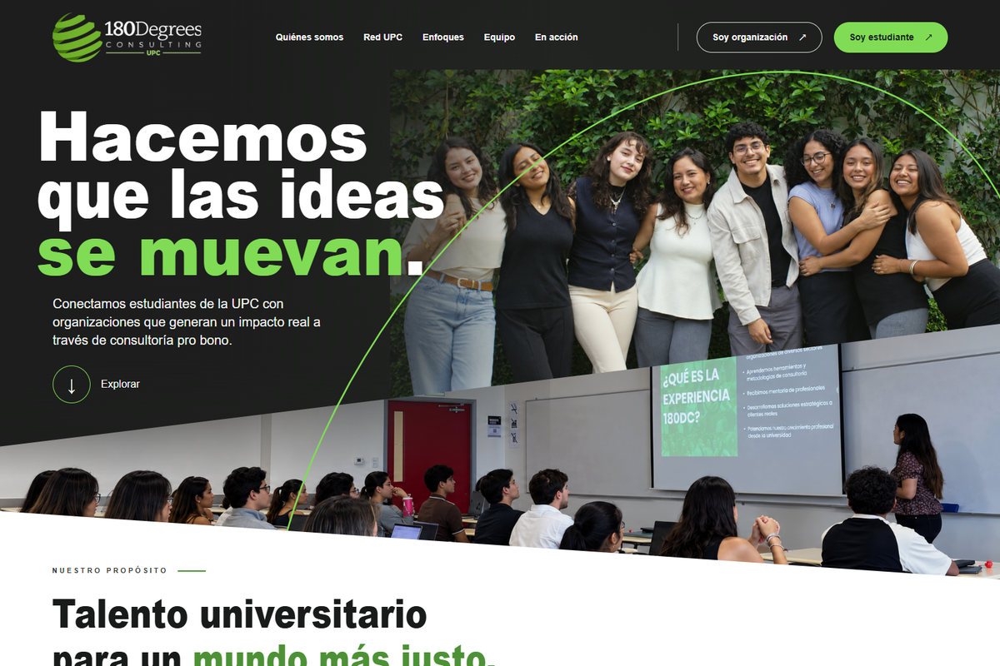
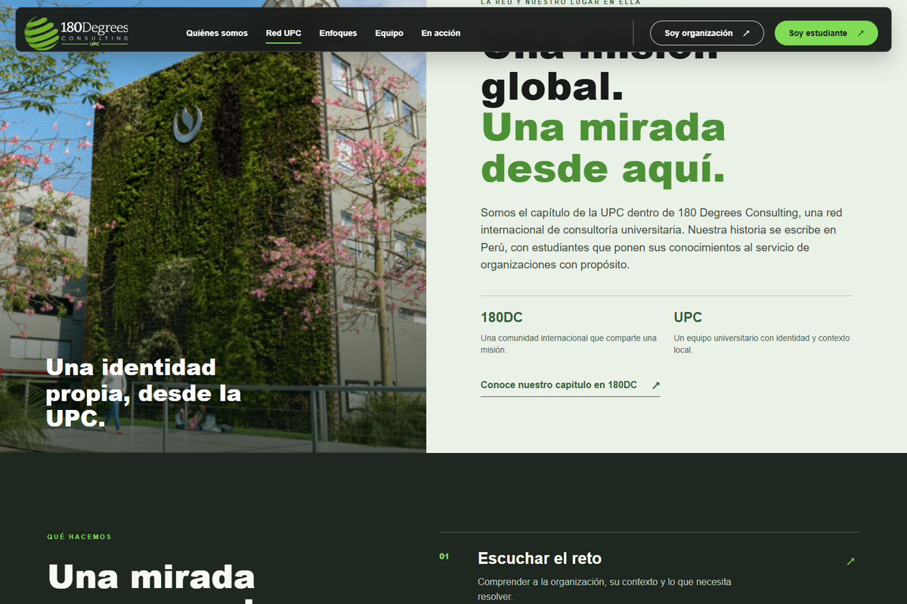
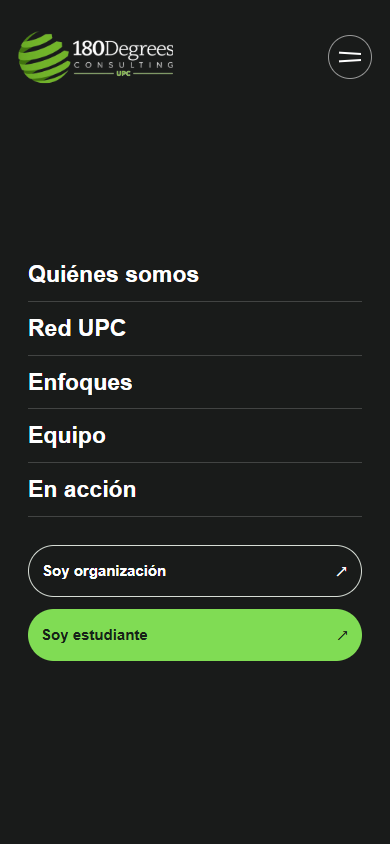
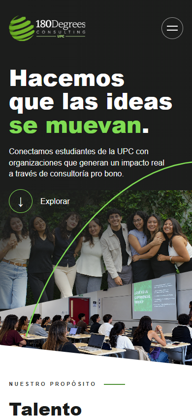
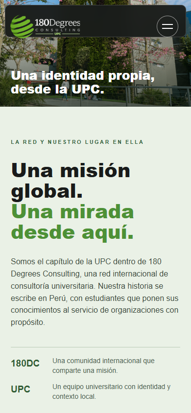
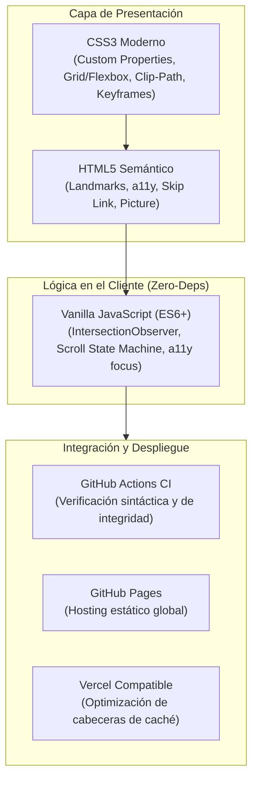

# 180 Degrees Consulting UPC — Landing Page Institucional

[](https://julioxc4.github.io/180dc-upc-ns/)
[](https://github.com/JulioXC4/180dc-upc-ns/actions)
[](https://github.com/JulioXC4/180dc-upc-ns)
[](https://github.com/JulioXC4/180dc-upc-ns)
[](LICENSE)

> **Solución frontend de alto rendimiento para el capítulo de la Universidad Peruana de Ciencias Aplicadas (UPC) de 180 Degrees Consulting en Lima, Perú.**  
> Diseñada y desarrollada para presentar la identidad del capítulo local, transmitir credibilidad estratégica, exhibir al equipo consultor y canalizar solicitudes de organizaciones sociales y postulantes universitarios.

---

## 🌐 Enlaces Rápidos

- 🚀 **Despliegue Oficial en GitHub Pages:** [https://julioxc4.github.io/180dc-upc-ns/](https://julioxc4.github.io/180dc-upc-ns/)
- 📦 **Repositorio:** [JulioXC4/180dc-upc-ns](https://github.com/JulioXC4/180dc-upc-ns)
- 🏛️ **Capítulo Oficial Global:** [180dc.org/branches/universidad-peruana-de-ciencias-aplicadas](https://www.180dc.org/branches/universidad-peruana-de-ciencias-aplicadas)

---

## 📸 Demostración Visual

### Vista Principal (Hero Section & Navegación Desktop)


### Experiencia Multiplataforma & Mobile Responsive
| Desktop: Contenido y Secciones | Mobile: Hero & Menú Lateral Accesible |
| :---: | :---: |
|  |  |

| Mobile: Experiencia de Lectura | Mobile: Navegación Fluida |
| :---: | :---: |
|  |  |

---

## 🎯 Contexto y Propósito del Proyecto

### ¿Qué es 180 Degrees Consulting?
**180 Degrees Consulting (180DC)** es la consultora estudiantil pro bono más grande del mundo, con presencia en más de 35 países. Conecta a estudiantes universitarios de alto rendimiento con organizaciones sin fines de lucro y empresas con propósito social para ofrecer asesoría estratégica de impacto.

### El Capítulo UPC (Perú)
Este proyecto representa específicamente al capítulo de la **Universidad Peruana de Ciencias Aplicadas (UPC)** en Lima, Perú. El sitio web fue concebido para resolver una necesidad de comunicación clave:
1. **Identidad Local con Estándar Global:** Proyectar la seriedad y el respaldo de la red global 180DC articulada con la personalidad, energía y contexto de la comunidad estudiantil de la UPC.
2. **Propuesta de Valor Clara:** Explicar cómo la consultoría pro bono ayuda a organizaciones con impacto a superar desafíos en diagnóstico, crecimiento, comunicación y sostenibilidad.
3. **Conversión y Contacto Directo:** Diseñar llamadas a la acción (*CTAs*) con intenciones diferenciadas: una para organizaciones que necesitan asesoría y otra para estudiantes de la UPC interesados en sumarse al equipo.
4. **Transparencia Institucional:** Exponer al equipo directivo real del capítulo con sus roles oficiales y enlazar la actividad verificable de la comunidad.

---

## ⚡ Stack Tecnológico y Arquitectura

Para este proyecto se tomó la decisión deliberada de utilizar un **stack web nativo (Vanilla)**, priorizando rendimiento extremo, cero fricción de compilación y máxima accesibilidad:



### Componentes Técnicos Clave

| Tecnología | Rol en el Proyecto | Justificación de Ingeniería |
| :--- | :--- | :--- |
| **HTML5 Semántico** | Estructura & Accesibilidad | Uso de etiquetas semánticas (`<header>`, `<main>`, `<section>`, `<article>`, `<figure>`, `<footer>`, `<details>`), atributos `aria-*` dinámicos y enlaces de salto (*skip-link*) para cumplir estándares WCAG. |
| **CSS3 Moderno & Variables** | Sistema de Diseño & Layout | Arquitectura basada en tokens CSS (`--lime`, `--green`, `--forest`, `--ink`), CSS Grid fluido, composición angular mediante `clip-path: polygon()`, y backdrop-filters de alto rendimiento. |
| **Vanilla JavaScript (ES6+)** | Interactividad & Animaciones | **0 dependencias externas.** Aprovechamiento de APIs nativas de alta eficiencia: `IntersectionObserver` para scrollspy y reveal animations, listeners pasivos y manejo de accesibilidad con teclado. |
| **Vercel / GitHub Pages** | Infraestructura & CDN | Despliegue inmediato en el edge, con reglas de caché inmutable para assets estáticos y cabeceras configuradas en `vercel.json`. |
| **GitHub Actions** | Integración Continua (CI) | Pipeline automatizado que valida integridad de archivos clave y sintaxis de JavaScript en cada push o pull request. |

---

## 🎨 Identidad Gráfica y Sistema de Diseño

El diseño traduce la guía visual de **180 Degrees Consulting** y la adapta a una estética digital moderna y sofisticada:

### 1. Paleta Cromática y Tokens CSS
```css
:root {
  /* Marca e Identidad */
  --green:  #4d9136; /* Verde institucional equilibrado */
  --lime:   #80dc54; /* Acento dinámico de alta energía (inspirado en #73B744 / #90C03E) */
  --forest: #315f3b; /* Tono de contraste para etiquetas y subtítulos */
  
  /* Superficies y Tipografía */
  --ink:    #191b1a; /* Tinta oscura profunda para fondos y texto */
  --dark:   #1c1e1d; /* Superficies secundarias oscuras */
  --paper:  #fafbf8; /* Fondo claro marfil para descanso visual */
  --muted:  #5c625e; /* Texto descriptivo atenuado */
  --line:   #d6ddd5; /* Bordes estructurales sutiles */
}
```

### 2. Tipografía Optimizada para Pantalla
- **Titulares (`--display`):** `Manrope`, sans-serif geométrica con terminaciones modernas, inspirada en la presencia corporativa de *Avenir*.
- **Cuerpo de Texto (`--body`):** `DM Sans`, de alta legibilidad en pantallas retina y tamaños compactos, inspirada en la neutralidad de *Lato*.
- **Preconexión a fuentes:** `<link rel="preconnect">` implementado para eliminar retrasos de renderizado (FOIT/FOUT).

### 3. Storytelling Visual & Geometría
- **Arco Vectorial SVG Dinámico:** El hero incorpora una curva fluida SVG (`pathLength="100"`) que se dibuja automáticamente al cargar la página mediante `@keyframes draw-arc`, simbolizando el giro de 180° y la dirección estratégica.
- **Composición Fotográfica Multinivel:** Técnica de máscaras diagonales (`clip-path: polygon(...)`) y degradados alpha que fusionan las fotografías de los talleres y el equipo directivo con el fondo oscuro institucional.

---

## 💡 Aporte y Decisiones de Ingeniería Frontend

Como desarrollador frontend, este repositorio demuestra habilidades prácticas aplicables a productos digitales en producción:

### 1. Arquitectura de Cero Dependencias (Zero-Dependency Mindset)
En lugar de sobrecargar una página de aterrizaje con frameworks pesados (React, Next.js, librerías infladas de animación) que incrementan el bundle size a megabytes, la landing se construyó íntegramente con capacidades web modernas nativas:
- **Peso total de scripts:** `< 3 KB` sin minificar (frente a los ~150-300 KB que introduciría un runtime de framework).
- **Tiempo de bloqueo del hilo principal (TBT):** Prácticamente `0 ms`.
- **First Contentful Paint (FCP) y LCP ultra rápidos**, garantizando una experiencia instantánea en redes móviles.

### 2. Animaciones Escalables con `IntersectionObserver`
- Las animaciones de revelado (`[data-reveal]`) están desacopladas del hilo principal de scroll:
  ```javascript
  const observer = new IntersectionObserver((entries) => {
    for (const entry of entries) {
      if (entry.isIntersecting) {
        entry.target.classList.add('is-visible');
        observer.unobserve(entry.target); // Libera memoria de inmediato
      }
    }
  }, { rootMargin: '0px 0px -45px 0px', threshold: 0.05 });
  ```
- Soporte estricto para usuarios con sensibilidad al movimiento mediante consulta de medios:
  ```javascript
  if (window.matchMedia('(prefers-reduced-motion: reduce)').matches) {
    // Desactiva animaciones de desplazamiento respetando la accesibilidad del SO
  }
  ```

### 3. Header Inteligente y Scrollspy en Tiempo Real
- Detección precisa de la sección activa mientras el usuario se desplaza, actualizando `aria-current="location"` dinámicamente en los enlaces de la barra de navegación.
- Transición de contraste bifásica: el encabezado cambia su tamaño y aplica `backdrop-filter: blur(16px)` al hacer scroll, adaptando sus colores al pasar de la sección oscura (Hero) a las secciones claras (Propósito y Equipo).

### 4. Accesibilidad (a11y) y Experiencia de Usuario (UX)
- **Skip Link funcional:** Permite a usuarios de lectores de pantalla saltar directamente al contenido principal (`#contenido`).
- **Navegación Móvil Accesible:** El botón de menú conmuta los estados `aria-expanded` y `aria-label`, y se cierra automáticamente con la tecla `Escape` o al seleccionar cualquier enlace.
- **Foco Visible de Alto Contraste:** Estilos personalizados `:focus-visible` con anillo lime `#80dc54` para navegación con teclado.
- **Acordeones Nativos:** La sección de *Enfoques* utiliza `<details class="focus-item" name="focus">`, permitiendo funcionamiento nativo de acordeón exclusivo (HTML5) sin librerías externas.

### 5. Optimización de Medios y Formatos de Nueva Generación
- Inclusión de formatos de última generación (`.webp`, `.avif`, `.svg`).
- Implementación de `fetchpriority="high"` en la imagen principal del hero y `loading="lazy"` en todas las imágenes bajo el pliegue (*below-the-fold*).
- Metadatos completos de **Open Graph** y **Twitter Cards** con imagen pre-generada (`og-image.jpg` 1200x630) para previsualizaciones impecables al compartir en LinkedIn, WhatsApp o Twitter.

---

## 📂 Estructura del Repositorio

```text
180dc-upc-ns/
├── .github/
│   └── workflows/
│       └── ci.yml               # Pipeline de validación de sintaxis e integridad
├── assets/
│   ├── 180dc-upc-logo.png       # Logotipo institucional
│   ├── og-image.jpg             # Tarjeta social de alta resolución (Open Graph)
│   ├── favicon.png              # Favicon institucional
│   ├── upc-campus.png           # Fotografía del campus UPC
│   ├── equipo-hero-editado.png  # Composición del hero (equipo)
│   ├── taller-hero-editado.png  # Composición del hero (taller en acción)
│   ├── workshop-photo.jpg       # Fotografía de taller de trabajo
│   ├── ig-*.jpg                 # Muestras de publicaciones de la comunidad
│   └── *.webp / *.avif          # Retratos optimizados del equipo directivo
├── docs/
│   └── screenshots/             # Capturas de pantalla reales (Desktop & Mobile)
├── .gitignore                   # Exclusiones estándar y de temporales
├── index.html                   # Documento HTML5 semántico y accesible
├── LICENSE                      # Licencia de código abierto MIT
├── package.json                 # Metadatos del proyecto y scripts de desarrollo
├── README.md                    # Documentación técnica y portafolio profesional
├── script.js                    # Lógica Vanilla JS (IntersectionObserver, Scrollspy, a11y)
├── styles.css                   # Sistema de diseño, tokens CSS, responsive y animaciones
└── vercel.json                  # Configuración de despliegue y caché estática en Vercel
```

---

## 🛠️ Ejecución Local

Dado que el proyecto utiliza tecnologías web nativas, no requiere compiladores, transpiladores ni procesos pesados de build. Puedes ejecutarlo localmente con cualquiera de las siguientes opciones:

### Opción 1: Con Node.js / npx (Recomendado)
```bash
# Clonar el repositorio
git clone https://github.com/JulioXC4/180dc-upc-ns.git
cd 180dc-upc-ns

# Iniciar servidor local
npm start
# O alternativamente:
npx serve .
```

### Opción 2: Con Python
```bash
python -m http.server 3000
# Abre http://localhost:3000 en tu navegador
```

### Opción 3: Con la extensión Live Server de VS Code
1. Abre la carpeta del proyecto en **Visual Studio Code**.
2. Haz clic derecho en [`index.html`](index.html) y selecciona **"Open with Live Server"**.

---

## 🚀 Despliegue en Producción

### GitHub Pages (Configurado)
El repositorio cuenta con despliegue continuo en **GitHub Pages** desde la rama `main`:
- **URL activa:** [https://julioxc4.github.io/180dc-upc-ns/](https://julioxc4.github.io/180dc-upc-ns/)

### Despliegue en Vercel
El repositorio está preparado para importarse directamente en [Vercel](https://vercel.com):
1. Importa el repositorio `JulioXC4/180dc-upc-ns` desde el dashboard de Vercel.
2. Vercel detectará el archivo [`vercel.json`](vercel.json) y aplicará automáticamente las directivas de caché y URLs limpias.
3. Despliegue en 1 clic sin pasos de configuración adicionales.

---

## 👤 Autor y Contacto

**Julio C. (JulioXC4)**  
*Desarrollador Frontend & Creador de Experiencias Web*

- **GitHub:** [@JulioXC4](https://github.com/JulioXC4)
- **Repositorio:** [github.com/JulioXC4/180dc-upc-ns](https://github.com/JulioXC4/180dc-upc-ns)
- **Demo:** [julioxc4.github.io/180dc-upc-ns](https://julioxc4.github.io/180dc-upc-ns/)

---

## 📄 Licencia

Este proyecto está bajo la Licencia [MIT](LICENSE). Las marcas comerciales, logotipos institucionales y fotografías de miembros pertenecen a sus respectivos titulares y a **180 Degrees Consulting / UPC**.
