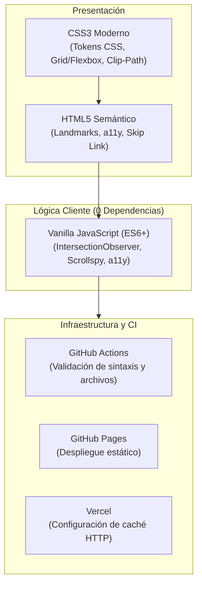

# 180 Degrees Consulting UPC — Landing Page

[](https://julioxc4.github.io/180dc-upc-ns/)
[](https://github.com/JulioXC4/180dc-upc-ns/actions)
[](https://github.com/JulioXC4/180dc-upc-ns)
[](https://github.com/JulioXC4/180dc-upc-ns)
[](LICENSE)

Landing page institucional para el capítulo de la Universidad Peruana de Ciencias Aplicadas (UPC) de 180 Degrees Consulting (Lima, Perú). El sitio comunica la misión del capítulo, presenta al equipo directivo y canaliza el contacto tanto para organizaciones que buscan consultoría pro bono como para estudiantes universitarios interesados en postular.

---

## Enlaces

- Demo en GitHub Pages: [https://julioxc4.github.io/180dc-upc-ns/](https://julioxc4.github.io/180dc-upc-ns/)
- Repositorio: [https://github.com/JulioXC4/180dc-upc-ns](https://github.com/JulioXC4/180dc-upc-ns)
- Página oficial de la red 180DC: [180dc.org/branches/universidad-peruana-de-ciencias-aplicadas](https://www.180dc.org/branches/universidad-peruana-de-ciencias-aplicadas)

---

## Vistas del Proyecto

### Vista Principal (Hero Section & Navegación Desktop)


### Navegación y Adaptación Mobile
| Desktop: Contenido y Secciones | Mobile: Navegación y Menú |
| :---: | :---: |
|  |  |

| Mobile: Portada | Mobile: Vista de Secciones |
| :---: | :---: |
|  |  |

---

## Contexto del Proyecto

180 Degrees Consulting es una red global de consultoría estudiantil enfocada en asesorar a organizaciones sin fines de lucro y proyectos de impacto social.

Este repositorio corresponde a la landing page independiente del **capítulo de la Universidad Peruana de Ciencias Aplicadas (UPC)** en Lima, Perú. El proyecto atiende tres objetivos concretos:

1. **Posicionamiento local:** Diferenciar la presencia del capítulo de la UPC dentro del marco de la red global, mostrando al equipo real y actividades locales.
2. **Claridad en servicios:** Explicar los cuatro ejes de consulta (diagnóstico estratégico, crecimiento, comunicación y sostenibilidad) indicando claramente que los alcances específicos se coordinan de forma personalizada con el capítulo.
3. **Conversión directa:** Canales de contacto diferenciados vía correo electrónico con asuntos predefinidos para organizaciones y para estudiantes postulantes.

---

## Arquitectura y Tecnologías

El proyecto se construyó deliberadamente con tecnologías web estándar sin frameworks de cliente (React, Vue o similares), con el objetivo de eliminar sobrecarga de dependencias, minimizar tiempos de carga y mantener la base de código simple de auditar.



### Detalle del Stack

- **HTML5 Semántico:** Marcado con etiquetas de estructura (`<header>`, `<main>`, `<section>`, `<article>`, `<figure>`, `<footer>`, `<details>`), textos alternativos descriptivos, enlaces de omisión (`.skip-link`) y soporte para atributos ARIA de navegación.
- **CSS3 Moderno:** Variables CSS para el sistema de diseño, composición mediante `display: grid` y `flexbox`, recortes visuales con `clip-path: polygon()`, y transiciones de aceleración gráfica por hardware.
- **JavaScript (ES6+ puro):** Menos de 3 KB de script sin comprimir. Utiliza `IntersectionObserver` nativo para animaciones de revelado y seguimiento de sección activa en la barra de navegación, sin recurrir a bibliotecas externas.
- **Optimización de Assets:** Formatos WebP y AVIF para retratos de equipo, SVG vectorial en el imagotipo y curva del hero, y metadatos Open Graph (`assets/og-image.jpg`) para previsualizaciones en redes sociales y mensajería.
- **GitHub Actions:** Flujo de integración continua que verifica la presencia de archivos críticos y ejecuta pruebas de sintaxis JavaScript en cada commit.

---

## Sistema de Diseño e Identidad

El diseño toma como base la paleta de identidad de 180 Degrees Consulting y la normaliza en tokens CSS:

### Paleta de Color
```css
:root {
  --green:  #4d9136; /* Verde institucional */
  --lime:   #80dc54; /* Tono de acento interactivo */
  --forest: #315f3b; /* Verde oscuro para etiquetas y contrastes */
  --ink:    #191b1a; /* Tinta oscura para texto y fondos contrastados */
  --dark:   #1c1e1d; /* Fondo secundario oscuro */
  --paper:  #fafbf8; /* Superficie clara */
  --muted:  #5c625e; /* Texto descriptivo secundario */
  --line:   #d6ddd5; /* Delimitadores estructurales */
}
```

### Tipografía
- **Titulares:** `Manrope` (Google Fonts), sans-serif geométrica seleccionada como equivalente web accesible al estilo institucional de *Avenir*.
- **Texto continuo:** `DM Sans` (Google Fonts), elegida por su legibilidad en pantallas compactas y relación con *Lato*.

### Elementos Gráficos
- **Curva SVG animada:** Trazado vectorial dinámico en el hero que ilustra la idea de movimiento y cambio de dirección, animado mediante `stroke-dasharray` y `stroke-dashoffset`.
- **Composición fotográfica angular:** Máscaras angulares mediante `clip-path` para integrar retratos de equipo y talleres con el fondo oscuro.

---

## Decisiones Técnicas y Frontend

### 1. Manejo Eficiente de Animaciones y Scroll
- Las animaciones de revelado (`[data-reveal]`) se controlan mediante `IntersectionObserver`. Cuando un elemento entra en el área visible, se le añade la clase `.is-visible` y se desuscribe del observador para evitar consumo residual de CPU o memoria.
- Se respeta la directiva de accesibilidad del sistema operativo:
  ```javascript
  if (window.matchMedia('(prefers-reduced-motion: reduce)').matches) {
    reveals.forEach((element) => element.classList.add('is-visible'));
  }
  ```

### 2. Barra de Navegación y Scrollspy
- El encabezado cambia su tamaño y aplica `backdrop-filter: blur(16px)` una vez superados los primeros 30px de desplazamiento vertical.
- Un segundo `IntersectionObserver` monitorea qué sección del documento ocupa la mayor proporción de la ventana gráfica, actualizando la clase activa y el atributo `aria-current="location"` en el enlace correspondiente del menú.

### 3. Accesibilidad de Navegación
- Menú móvil con manejo de estado sincronizado: alternancia de `aria-expanded` y `aria-label` en el botón de activación.
- El menú se cierra automáticamente al pulsar `Escape` o al seleccionar cualquier enlace interno, restableciendo el scroll del documento (`overflow: hidden` en `body.menu-open`).
- Foco visible accesible (`:focus-visible`) con contorno de alto contraste sobre fondo oscuro y claro.

### 4. Acordeones Nativos sin JavaScript
- La sección de *Enfoques* utiliza elementos `<details class="focus-item" name="focus">`. Al compartir el atributo `name`, el navegador gestiona automáticamente el comportamiento exclusivo (solo un panel abierto a la vez) sin requerir código JavaScript adicional.

---

## Estructura de Archivos

```text
180dc-upc-ns/
├── .github/
│   └── workflows/
│       └── ci.yml               # Pipeline de validación de sintaxis e integridad
├── assets/
│   ├── 180dc-upc-logo.png       # Logotipo institucional
│   ├── og-image.jpg             # Imagen de previsualización para Open Graph
│   ├── favicon.png              # Icono de pestaña
│   ├── upc-campus.png           # Imagen de campus UPC
│   ├── equipo-hero-editado.png  # Fotomontaje del hero (equipo)
│   ├── taller-hero-editado.png  # Fotomontaje del hero (taller)
│   ├── workshop-photo.jpg       # Fotografía de taller
│   ├── ig-*.jpg                 # Capturas de actividad comunitaria
│   └── *.webp / *.avif          # Retratos individuales del equipo
├── docs/
│   └── screenshots/             # Capturas de pantalla reales (Desktop y Mobile)
├── .gitignore                   # Reglas de exclusión de git
├── index.html                   # Estructura semántica y metadatos SEO / Open Graph
├── LICENSE                      # Licencia MIT
├── package.json                 # Definición de proyecto y scripts de ejecución
├── README.md                    # Documentación del proyecto
├── script.js                    # Interactividad cliente (IntersectionObserver, scroll, a11y)
├── styles.css                   # Sistema de diseño, diseño adaptativo y animaciones
└── vercel.json                  # Reglas de caché y enrutamiento para Vercel
```

---

## Ejecución Local

El proyecto no requiere compilación previa. Se puede servir de forma local mediante cualquiera de estos métodos:

### Con Node.js
```bash
git clone https://github.com/JulioXC4/180dc-upc-ns.git
cd 180dc-upc-ns
npm start
```

### Con Python
```bash
python -m http.server 3000
```
Luego abrir `http://localhost:3000` en el navegador.

### Con Live Server (VS Code)
Abrir el archivo [`index.html`](index.html) en Visual Studio Code y seleccionar **"Open with Live Server"**.

---

## Despliegue

### GitHub Pages
El sitio se publica automáticamente desde la rama `main`:
- URL: [https://julioxc4.github.io/180dc-upc-ns/](https://julioxc4.github.io/180dc-upc-ns/)

### Vercel
Compatible mediante importación directa del repositorio. El archivo [`vercel.json`](vercel.json) define cabeceras `Cache-Control: public, max-age=31536000, immutable` para la carpeta `/assets/`.

---

## Autor

**Julio C. (JulioXC4)**

- GitHub: [@JulioXC4](https://github.com/JulioXC4)
- Repositorio: [github.com/JulioXC4/180dc-upc-ns](https://github.com/JulioXC4/180dc-upc-ns)

---

## Licencia

Distribuido bajo la Licencia [MIT](LICENSE). Las marcas, logotipos y nombres institucionales pertenecen a 180 Degrees Consulting y a la Universidad Peruana de Ciencias Aplicadas.
